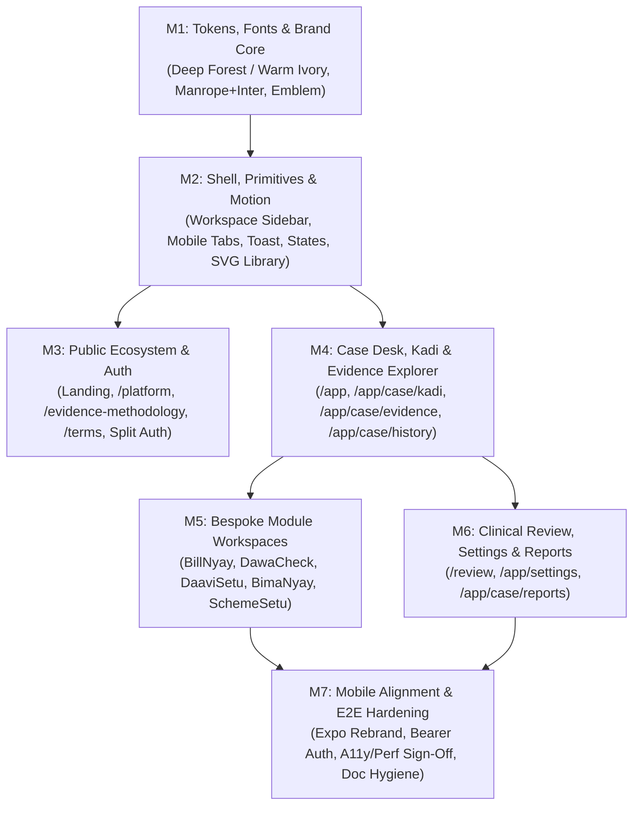

# ArogyaRakshak — Prioritised Implementation Roadmap & Backlog

**Execution Model:** Incremental, milestone-gated delivery preserving CI green status (`pytest`, `lint-imports`, `web tests`, `web-bundle-budget <= 170 KB gzip`, `mobile tests`, `contrast.mjs`) at every single PR.

---

## 1. Dependency Map

---

## 2. Prioritised Implementation Backlog & Milestone Acceptance Criteria

### Milestone 1 (P0): Design Tokens, Typography & Brand Core
- **Scope:**
  - Update `packages/design-tokens/tokens.json` to **Deep Forest / Warm Ivory** Light-first + optional Dark mode + 6 semantic tiers.
  - Flip `layout.tsx` pre-paint theme default to `light`.
  - Swap Fraunces/Plus Jakarta Sans → self-hosted `@fontsource-variable/manrope` + `@fontsource-variable/inter` + `@fontsource-variable/jetbrains-mono`.
  - Build `ArogyaEmblem`, `ArogyaWordmark`, `ArogyaLogoAnimated`, `ArogyaLoader`, 6 custom module SVG icons, and PWA PNG/SVG icons (`192`, `512`, `apple-touch-icon`).
- **Acceptance Criteria:**
  - `packages/design-tokens/contrast.mjs` passes **100%** of pairs in Light & Dark (`0` failures).
  - `npm run check:generated` passes across web and mobile.
  - Zero external font requests; `CLS = 0` on `/`; all routes remain `<= 170 KB gzip`.

### Milestone 2 (P0): Workspace Shell, UI Primitives Adoption & Illustration/Motion Foundation
- **Scope:**
  - Build Workspace Sidebar (`>= 1280px`), collapsible rail (`1024–1279px`), and Mobile Bottom 5-Tab Bar (`< 768px`).
  - Mount `ToastProvider` in root layout; fix `ConfirmationDialog` initial focus to Cancel.
  - Consolidate `EvidenceBadge` (6 semantic tiers) and retire legacy `clinical/StatePanel.tsx` in favour of `ui/States.tsx`.
  - Author tokenized SVG illustration library (12 domain illustrations + 5 ambient scientific backgrounds) and `app/motion/` wrappers honoring OS + in-app `data-motion="reduce"`.
- **Acceptance Criteria:**
  - Zero emoji icons remain in navigation/module tabs.
  - `tests/tokens_adoption.test.ts` and `tests/icons.test.ts` pass; ESLint confirms `motion` confined to `app/motion/**`.

### Milestone 3 (P0): Flagship Public Site & Split-Screen Auth
- **Scope:**
  - Implement Landing Page (`/`) synthesizing Stitch Primary (`5fdc7a05...`) + Editorial & Scientific variants (`9b26009a...`, `b7c94cf8...`).
  - Refresh `/platform`, `/platform/[module]` (×6), `/how-it-works`, `/security`, `/about`, `/help`.
  - Add `/evidence-methodology`, `/trust`, and `/terms` as pure Server Components.
  - Upgrade `/login`, `/register`, `/forgot-password`, `/reset-password`, `/verify` to the 45/55 Deep Forest split layout (`2471128a...`).
- **Acceptance Criteria:**
  - Zero client copy bloat on public routes (`/` and `/platform/*` `< 155 KB gzip`).
  - `0px` horizontal overflow across `360, 390, 768, 1024, 1280, 1440px` on all 15 public/auth routes.
  - `/forgot-password` and `/verify` accurately disclose `MAIL_TRANSPORT=disabled` while handling `#token=` links securely.

### Milestone 4 (P1): Case Desk, Kadi Workspace & Signature Evidence Explorer
- **Scope:**
  - Redesign `/app` Case Desk (`20aa2636...`) with BYOD upload dropzone, owned + guest cases list, 6 module shortcuts, and Activity/SLA Rail.
  - Launch `/app/case/kadi` (4-stage SSE rail, Document Provenance Cards with redacted excerpt overlay, Entity Resolution queue, ABDM FHIR import drawer).
  - Launch `/app/case/evidence` (`ee1967ba...`) with interactive provenance graph, filter bar, upstream/downstream path highlight, right-hand Provenance Inspector Drawer, and mobile list/graph toggle.
  - Launch `/app/case/history` append-only case audit timeline.
- **Acceptance Criteria:**
  - Live SSE upload → extraction → graph rendering verified end-to-end against local FastAPI + Postgres 16.
  - Case ID never appears in any URL; raw file never persisted.
  - Evidence Explorer fully keyboard-navigable + includes accessible HTML table equivalent.

### Milestone 5 (P1): Five Bespoke Module Workspaces & Visualisations
- **Scope:**
  - **BillNyay (`95be66a3...`):** Promote `StackedBarChart`, `WaterfallChart`, `DataTable`, wire `/icd-audit`, `/grievance`, `/outcome-estimate`.
  - **DawaCheck (`275f3364...`):** Enhanced `PriceBar`, prominent Trust Gate holdout cards, Rx shorthand translator, read-aloud.
  - **DaaviSetu (`666810eb...`):** Promote `StepWizard` + `DonutChart` completeness ring, wire `/claim/fill-template`, preserve AES-256-GCM packaging.
  - **BimaNyay (`fc0c3bba...`):** 3-Column Adjudication Studio, promote `TimelineChart` 3-tier SLA rail, trilingual appeal tabs.
  - **SchemeSetu (`4c9fa17d...`):** Civic eligibility cards, `ReasoningFlowChart`, `TrendLineChart`, wire `/eligibility/{reasoning,trend,transition}`.
- **Acceptance Criteria:**
  - Every chart renders real backend data with mandatory `source`, `units`, `basis`, and `
` data table.
  - Zero fabricated approval odds, zero unit-blind medicine percentages, zero "Submitted" insurer claims.

### Milestone 6 (P1): Clinical Review Portal, Reports Centre & Settings/Privacy
- **Scope:**
  - Redesign `/review` (`a6dc0d84...`) including inner components (`StatementEditor`, `EvidencePanel`, `FactConfirmations`, `SafetyTab`).
  - Redesign `/app/settings` (`a49396f7...`) with Profile, Accessibility, Privacy/BYOD Retention, Danger Zone, and Case-Scoped Notifications/SLA Feed.
  - Redesign `/app/case/reports` with live HMAC verification badge and client-side AES-GCM unlock tool.
- **Acceptance Criteria:**
  - End-to-end doctor review lifecycle (register → COI declare → accept → draft → lock → finalize → PDF re-sign) verified in browser.
  - Account deletion & single-case deletion verified to purge all derived rows cleanly.

### Milestone 7 (P2): Mobile Alignment, QA Sign-Off & Documentation Hygiene
- **Scope:**
  - Apply Deep Forest / Warm Ivory tokens + Manrope/Inter to `apps/mobile` (`ca7216e9...` layout); complete Wave 3 M7 Bearer auth, owned-case header downloads, and local SLA reminders.
  - Decompose remaining legacy `globals.css` rules.
  - Fix verified doc-vs-code drift in `README.md`, `PROJECT_CONTEXT.md`, `docker-compose.yml`, and backend docstrings.
  - Coordinate native-speaker Hindi/Marathi review for all `UNREVIEWED` copy.
- **Acceptance Criteria:**
  - All backend (`pytest`), web (`npm test`, `lint`, `tsc`, `build`, `check:web-budget`), mobile (`npm test`, `tsc`, Android bundle `< 2.6 MB`), `lint-imports` (6/6), and `ci_guardrails` pass.
  - Lighthouse mobile `LCP <= 2000ms`, `CLS <= 0.05`, Accessibility `>= 95`.
