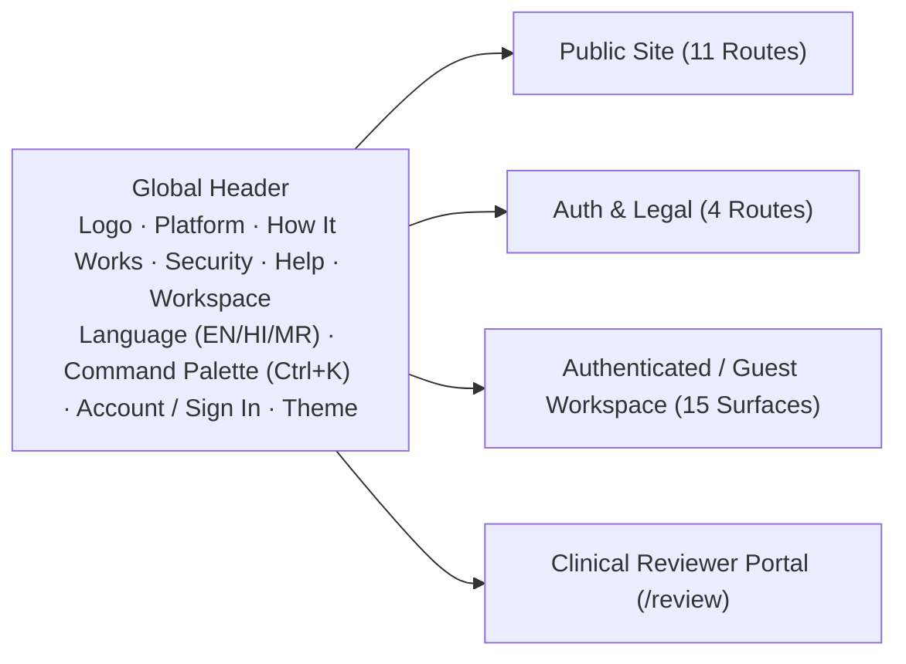

# ArogyaRakshak — Complete Page Inventory & Navigation Map

**Status:** Approved Planning Blueprint  
**Coverage:** 15 Public & Auth Routes + 16 Authenticated/Workspace & Clinical Routes (31 Total Surfaces)

---

## 1. Global Navigation Map

- **Desktop Header (`>= 1280px`):** Brand Emblem + Wordmark | Inline links (`Platform`, `How It Works`, `Security`, `Help`, `Workspace`) | Right utilities: `Cmd/Ctrl+K` Search, Language Switcher (`EN / हिं / मर`), Theme Toggle (Light default / optional Dark), Account Menu / Sign In CTA.
- **Tablet & Mobile (`< 1280px`):** Brand Emblem + Wordmark | Language Pill | Account/Action | `<dialog>` Navigation Drawer (public) + Bottom 5-Tab Bar (`Home`, `Scan`, `Cases`, `Tools`, `Settings`) inside Workspace & Mobile App.
- **Command Palette (`Ctrl/Cmd + K`):** Instant keyboard navigation across all public pages, workspace routes, module shortcuts, and active-case entities.

---

## 2. Public-Facing Experience Inventory (15 Pages)

All public informational pages MUST remain **Next.js Server Components** (zero client copy bundles) to protect the **170 KB gzip** initial JS budget.

| # | Route | Page Name | Status | Purpose & Target User | Primary Layout & Key Components | Data & API Dependencies | Empty / Loading / Error States | Mobile & A11y Requirements |
|---|---|---|---|---|---|---|---|---|
| P01 | `/` | **Main Landing Page** | Enhance | First impression for patients, families, clinicians & evaluators; explains ArogyaRakshak before login | Asymmetric hero with scientific botanical-molecular SVG + live scan visual; 6-module interactive showcase; 4-step workflow diagram; 6-state Evidence Provenance showcase; BYOD privacy story; FAQ preview; structured footer | Static SSR + `referenceSnapshot.ts` (27 CGHS rows, 7 NPPA drugs, 5 law provisions) | Static SSR (zero loading spinner); graceful fallback if demo status unreachable | 1-col stack `<768px`, 0px horizontal overflow, single `<h1>`, roving tabindex on module tabs |
| P02 | `/about` | **About ArogyaRakshak** | Enhance | Mission, Indian healthcare context, core principles, team/academic origin, explicit "What ArogyaRakshak Is Not" | Editorial narrative column + 4 principle cards + honest scope matrix | Static SSR copy | Static SSR | Fluid type `clamp()`, `lang` attribute switching |
| P03 | `/how-it-works` | **How the Platform Works** | Enhance | End-to-end visual walkthrough from document upload to human-verified action | Interactive 6-stage vertical/horizontal process diagram (Upload in RAM → OCR Gate → Extraction → Trust Gate → Module Audit → Human Review & Action) + cross-module context diagram | Static SSR + SVG workflow diagrams | Static SSR | Vertical stepper on mobile, keyboard-focusable stage disclosures |
| P04 | `/platform` | **All Modules Overview** | Enhance | Explains the 6-module ecosystem, Kadi shared layer, consent-gated context, and Guest vs Account access | Bento architecture grid with 6 distinct module cards, Kadi hub diagram, Guest vs Account comparison table | Static SSR + `referenceSnapshot.ts` | Static SSR | 1-col card stack on mobile, responsive scrollable comparison table |
| P05 | `/platform/[module]` | **Individual Module Introductions (×6)** | Enhance | Deep dive into `kadi`, `billnyay`, `dawacheck`, `daavisetu`, `bimanyay`, `schemesetu` | Hero with module emblem & accent strip, Problem/Workflow split, Inputs/Outputs cards, labelled *Synthetic Worked Example*, Reference Data & Limitations disclosure, CTA to open module | Static SSR (`dynamicParams = false`, 6 generated paths) | Unknown slug → `not-found.tsx` (404) | `overflow-wrap: anywhere` for statutory codes/paths, `>=44px` tap targets |
| P06 | `/platform/kadi` | **Kadi Intelligence Explanation** | Enhance | Dedicated deep-dive on transient OCR, Devanagari text-quality gate, entity resolution, Medicine Trust Gate & provenance | Pipeline architecture visual, Trust Gate decision tree, dual-reader consensus diagram, PII redaction scope table | Static SSR | Static SSR | Collapsible technical `
` blocks on mobile |
| P07 | `/evidence-methodology` | **Evidence & Methodology** | New | Explains the 6 semantic provenance tiers, ADR-017 Explanation Trail, ADR-012 Price Basis, clinical plausibility vs necessity, and reference datasets | Interactive Provenance Matrix, sample Explanation Trail inspector, Reference Data Provenance Table (CGHS-2024-REVISED, NPPA 7-drug subset, IRDAI 2024, PM-JAY/MJPJAY) | Static SSR + `referenceSnapshot.ts` | Static SSR | Accessible `<table>` with `scope="col"`, high-contrast badges (icon + text, never colour alone) |
| P08 | `/security` | **Privacy & Security** | Enhance | Full technical transparency on BYOD zero retention, RAM-only processing, scrypt/cookie auth, AES-256-GCM packaging, 90-day purge | Data Lifecycle Table (What is processed vs What is stored vs When it is erased), Implemented Controls checklist, Honest Limitations section | Static SSR | Static SSR | Anchor deep-links (`#sec-flow-title`, `#sec-limits-title`), clear heading hierarchy |
| P09 | `/trust` | **Trust & Transparency** | New (or anchor in `/about` + `/security`) | Explicit "No Manufactured Authority" charter: clinical reviewer verification levels, safety board four-eyes governance, synthetic demo disclosure | Governance flow diagram, Verification Tier table (`Self-Declared` vs `Demo Only`), Safety Rule lifecycle visual | Static SSR | Static SSR | Screen-reader friendly diagram summaries |
| P10 | `/help` | **FAQ & Knowledge Base** | Enhance | Self-service answers across Privacy, Accounts, Modules, OCR, and Data Deletion | Live client-side searchable FAQ (`HelpSearch.tsx`, 18+ questions), category filter pills, module quick guides, deletion guide | Static JSON/TS copy (client search only, zero API call) | Empty search → "No matching questions" + reset button | Live count `aria-live="polite"`, native `
/
` |
| P11 | `/help#contact` | **Contact & Support** | Enhance | Clear channels for bug reports, clinical feedback, security disclosure (`SECURITY.md`), and academic team contact | Structured support cards (Security Disclosure, Technical Issue, Clinical Feedback, Emergency Disclaimer: *Not a medical emergency service*) | Static SSR | Static SSR | Clear external link indicators, emergency helpline callout |
| P12 | `/login` | **Sign In** | Enhance | Account authentication (`ADR-026`) with calm Guest Mode alternative | 45/55 Editorial split screen: Deep Forest trust panel + Warm Ivory card (`Email`, `Password`, `Show/Hide`, `Sign In`, `Continue as Guest`) | `POST /api/v1/kadi/auth/login` (`credentials: "include"`) | Loading spinner on button; uniform 401 message + rate-limit 429 `Retry-After` banner | Single-column card on mobile (trust pillars collapsed below), `autocomplete="email"` / `"current-password"` |
| P13 | `/register` | **Registration** | Enhance | New account creation with transparent 12-char NIST password policy & BYOD disclosure | Same 45/55 split layout; live client-side password rule checklist (12–128 chars, not email, not whitespace) | `POST /api/v1/kadi/auth/register` (uniform 202) | Uniform 202 acceptance state; inline validation errors (never echoing password) | `aria-describedby` linking password policy hints |
| P14 | `/forgot-password` & `/reset-password` | **Password Recovery** | Enhance | Honest recovery flow respecting `MAIL_TRANSPORT=disabled` while supporting `#token=` reset links | Focused centered card; `/forgot-password` clearly discloses email delivery status; `/reset-password` parses & strips `#token=` from URL immediately | `POST /kadi/auth/password-reset/request` & `/confirm` | Disabled-mail info banner; expired/used token 400 error state with guidance | Token stripped from URL before render (`history.replaceState`) |
| P15 | `/terms` (and `/verify`) | **Terms, Privacy & Consent Interfaces** | New (`/terms`) + Enhance (`/verify`) | Plain-language Terms of Use, DPDP Act 2023 alignment summary, explicit consent explanation, and email verification handler | Structured legal-editorial document with printable view + interactive Consent Scope Explainer | Static SSR (`/terms`); `POST /kadi/auth/verification/confirm` (`/verify`) | Invalid/expired verify token error state | Print stylesheet friendly, clear landmarks |

---

## 3. Authenticated & Workspace Experience Inventory (16 Surfaces)

Workspace routes support **both Signed-In Accounts** (`__Host-arogya_session` cookie) and **Guest Sessions** (`sessionStorage` case token, ADR-009), keeping the active Case ID out of the URL.

| # | Route | Surface Name | Status | Purpose & Target User | Layout & Key Components | API Dependencies | Empty / Loading / Error States | Mobile & A11y Requirements |
|---|---|---|---|---|---|---|---|---|
| W01 | `/app` | **Main Dashboard (Case Desk)** | Enhance | Central hub: personalised welcome, BYOD upload dropzone, owned + guest cases list, 6 module shortcuts, recent findings & review activity, SLA reminders | Workspace sidebar + 2-column main grid (Intake + Active Cases) + Right Activity Rail | `GET /kadi/auth/me`, `GET /kadi/cases`, `POST /kadi/cases`, `POST /kadi/cases/{id}/upload`, `POST /kadi/cases/{id}/claim`, `GET /kadi/clinical-demo/status` | No cases → guided "Start your first case" card; skeleton loaders; 401 session-expired banner | Bottom 5-tab bar, thumb-zone upload CTA, swipeable case cards |
| W02 | `/app/profile` (or tab in `/app/settings`) | **User Profile** | Enhance | Account identity, session status, verification badge, password update, active device session info | Settings layout with Profile Summary Card + Password Change Form | `GET /kadi/auth/me`, `POST /kadi/auth/password`, `POST /kadi/auth/logout` | Guest user → prompt to create account to save cases across devices | Clear form fieldsets, `aria-live` save confirmation |
| W03 | `/app/case` | **Personal Healthcare Workspace (Active Case Overview)** | Enhance | Unified command view for the active case: safety banner, Kadi readiness & auto-insights, resolution questions, documents kept, timeline preview, evidence graph preview | Case Context Header (Case ID, Owned/Guest badge, 90-day TTL countdown) + Safety Escalation Banner + Actionable Readiness Grid + Summary Cards | `GET /kadi/cases/{id}`, `/insights`, `/resolutions`, `/safety-escalations`, `/timeline`, `/graph`, SSE `/stream` | No active case → redirect/CTA to Case Desk; SSE live 4-stage rail; 403/404 recovery | Stacked cards, sticky compact case switcher bar |
| W04 | `/app/cases` (integrated in `/app`) | **Case Management** | Enhance | Filter, search, claim guest cases into account, inspect expiry dates, and delete cases | Search/filter bar (All / Owned / Guest / Needs Review), Case Cards with provenance chips, Claim button, Delete with `ConfirmationDialog` | `GET /kadi/cases`, `POST /kadi/cases/{id}/claim`, `DELETE /kadi/cases/{id}` | Empty filter → reset filter; failed delete → retryable error alert | `ConfirmationDialog` focus lands on Cancel button |
| W05 | `/app/case/kadi` | **Document Management & Kadi Intelligence Workspace** | New (split from `/app/case`) | Dedicated Kadi surface: upload additional documents, monitor SSE OCR/extraction stages, inspect Document Provenance Cards (SHA-256, redacted excerpt, OCR partial-page warnings), resolve duplicate entity questions, optional ABDM FHIR import | Top 4-Stage Pipeline Rail + Upload/Add-Doc Dropzone + Document Provenance Cards + Entity Resolution Review Queue + ABDM Import drawer | `POST /kadi/cases/{id}/upload`, `/stream`, `/resolutions`, `/resolutions/{id}/feedback`, `POST /kadi/cases/{id}/abdm/import` | Zero docs → upload prompt; OCR partial-page warning (`PartialResultState`); interrupted job re-upload prompt (ADR-019) | Camera scan trigger (`capture="environment"`), clear screen-reader progress announcements |
| W06 | `/app/case` nav rail | **Module Selection** | Enhance | Seamless switching across Kadi, BillNyay, DawaCheck, DaaviSetu, BimaNyay, SchemeSetu without losing active case | Left workspace sidebar (desktop) / horizontal scrollable pill bar (tablet/mobile) showing per-module readiness dot | `GET /kadi/cases/{id}/insights` | Unlinked modules show "Ready to run" or "Needs document" | `aria-current="page"`, `>=44px` touch targets |
| W07 | `/app/case/billnyay` | **BillNyay Workspace** | Enhance | Hospital bill audit vs CGHS-2024-REVISED, clinical plausibility, ICD-10 audit, 5-agent appeal letter & signed PDF, grievance tracker | Financial Summary Strip + Composition/Waterfall SVG Chart + Sortable `DataTable` with `ExplainTrail` + Paper Appeal Preview + Clinical Review Panel | `POST /billnyay/cases/{id}/audit`, `/appeal`, `GET /appeal/pdf`, `/appeal/verify`, `/clinical-plausibility`, `/icd-audit`, `POST /grievance`, `POST /outcome-estimate` | No bill entities → `EmptyState` with upload CTA; `InsufficientEvidenceState` for outcome estimate | Card-list fallback for audit table `<768px`, tabular numerals |
| W08 | `/app/case/dawacheck` | **DawaCheck Workspace** | Enhance | Per-unit NPPA ceiling check (ADR-012), Kadi Medicine Trust Gate, Jan Aushadhi substitutes, Prescription Shorthand Translator | Quick Price Check Bar + Case Medicine Cards (with `PriceBar` & Trust Gate holdouts) + Blind Transcription panel + Rx Shorthand Translator | `GET /dawacheck/cases/{id}/benchmark`, `POST /dawacheck/benchmark`, `POST /dawacheck/translate-instructions`, `/kadi/cases/{id}/transcriptions` | Held-back medicine → amber Trust Gate card (never price-checked); unmapped drug → honest refusal | Large Price Basis segmented control, Web Speech read-aloud button |
| W09 | `/app/case/daavisetu` | **DaaviSetu Workspace** | Enhance | Pre-authorisation document readiness, institution playbooks, doctor fact confirmations, Annexure-B PDF, template fill, AES-256-GCM encrypted ZIP | 3-Step Guided Wizard (`StepWizard`) + Document Completeness Ring Chart + Readiness Checklist + Annexure-B Form + Client-Side Crypto Package Builder | `POST /daavisetu/cases/{id}/readiness`, `/readiness/clinical-confirmations`, `POST /claim`, `GET /claim/pdf`, `/claim/package`, `POST /claim/fill-template` | Missing fields → structured 422 field recovery; ends at "Package Ready" (never "Submitted") | Step-by-step mobile wizard, clear password-strength guidance |
| W10 | `/app/case/bimanyay` | **BimaNyay Workspace** | Enhance | IRDAI Master Circular 2024 denial clause audit, 3-tier trilingual appeal studio (GRO / Bima Bharosa / Ombudsman), statutory SLA tracker | 3-Column Adjudication Studio: Dossier & Denied Share Bar \| Clause Audit Cards \| Trilingual Appeal Tabs + Top 3-Tier SLA Timeline | `POST /bimanyay/analyze`, `POST /bimanyay/timeline`, `GET /bimanyay/cases/{id}/clinical-statements` | Standalone mode works without a case; unverified clause clearly marked `Needs Attention` | Accordion/tabbed mobile layout, `ListenSummary` audio control |
| W11 | `/app/case/schemesetu` | **SchemeSetu Workspace** | Enhance | PM-JAY & MJPJAY provisional eligibility, regional state normalization, criterion-by-criterion reasoning trace, citation verification, trend/transition advice | Eligibility Input Form + 2-Column Scheme Cards + Interactive Reasoning Flow Diagram + Citation Status Badges + Trend/Transition Drawer | `POST /schemesetu/eligibility`, `/cases/{id}/eligibility`, `PUT/GET/DELETE /cases/{id}/income-profile`, `/eligibility/{reasoning,trend,transition}` | PM-JAY always `Needs Attention / Verification Needed` with official steps; income labelled non-determinative | Stacked scheme cards, clear Devanagari state alias feedback |
| W12 | `/app/case/evidence` | **Evidence Explorer** | New (elevated from `/app/case`) | Flagship visual relationship graph connecting Documents → Entities → Rules → Findings → Human Review | Interactive SVG Relationship Graph (`EvidenceGraph`) with pan/zoom/filter + Right-hand Provenance Inspector Drawer + Collapsible Accessible Table | `GET /kadi/cases/{id}/graph`, `/insights`, `/clinical-reviews`, `/resolutions` | Empty graph → upload prompt; node filter returns 0 → clear filter | List + relationship drill-down mode on mobile, full keyboard `<g role="button">` traversal |
| W13 | `/app/case/reports` | **Analysis Results & Reports Centre** | Enhance | Unified download & verification hub for Signed Appeal PDF, Annexure-B Pre-Auth PDF/ZIP, and Cross-Module Claim Pack | 3-Card Report Matrix with live SHA-256/HMAC integrity badge, client-side AES-GCM unlock utility, and per-case availability status | `GET /billnyay/cases/{id}/appeal/verify`, `/appeal/pdf`, `GET /daavisetu/cases/{id}/claim/{pdf,package}`, `GET /kadi/cases/{id}/claim-pack` | 409/404 probe → calm "Not yet generated for this case" with direct link to module | Blob-fetch download (never credential in URL), clear file-size & format tags |
| W14 | `/app/case/history` | **Processing & Audit History** | New (elevated from `/app/case`) | Chronological append-only case timeline combining Kadi ingestion, auto-triggers, OCR consensus, clinical reviews, and BimaNyay SLAs | Vertical interactive `TimelineChart` with provenance filter chips and expandable audit metadata | `GET /kadi/cases/{id}/timeline`, `GET /kadi/cases/{id}/clinical-reviews/{rid}/audit` | Single-event initial state | Compact vertical timeline on mobile, high-contrast timestamps |
| W15 | `/app/settings` | **Account Settings, Privacy Controls & Notifications** | Enhance | Manage Language, Theme, Simple Language, Read-Aloud, In-App Reduced Motion, Password, Data Deletion, and Case-Scoped Notifications/SLA Reminders | Left Settings Sub-Nav + Preferences Card + Privacy/BYOD Retention Card + Danger Zone (`ConfirmationDialog`) + Notifications/SLA Activity Feed | `GET /kadi/auth/me`, `POST /kadi/auth/password`, `DELETE /kadi/auth/me`, `DELETE /kadi/cases/{id}`, local preferences | Guest mode hides account-only cards and explains guest expiry | 44px+ switches, instant pre-paint theme & motion persistence |
| W16 | `/review` | **Human Review & Safety Governance Workspace** | Enhance | Clinical reviewer portal: doctor conflict-of-interest gate, redacted evidence review, verbatim immutable statements, blind dual-reader OCR transcription, four-eyes safety board | Reviewer Header (honest verification tier) + 3 Tabs (`Assigned Reviews`, `Blind OCR Transcriptions`, `Safety Rules`) + Queue \| Detail Split View + Append-Only Audit Trail | `/kadi/clinical-reviewers/*`, `/kadi/clinical-reviews/*`, `/kadi/transcriptions/*`, `/kadi/safety-rules/*` | Signed out → split Sign-In / Self-Register panel; empty queue → calm waiting state | Responsive queue-to-detail navigation on tablet/mobile; explicit confirmation sentence before finalize |
