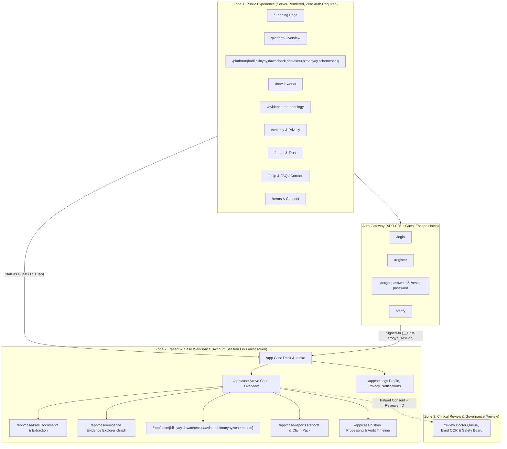
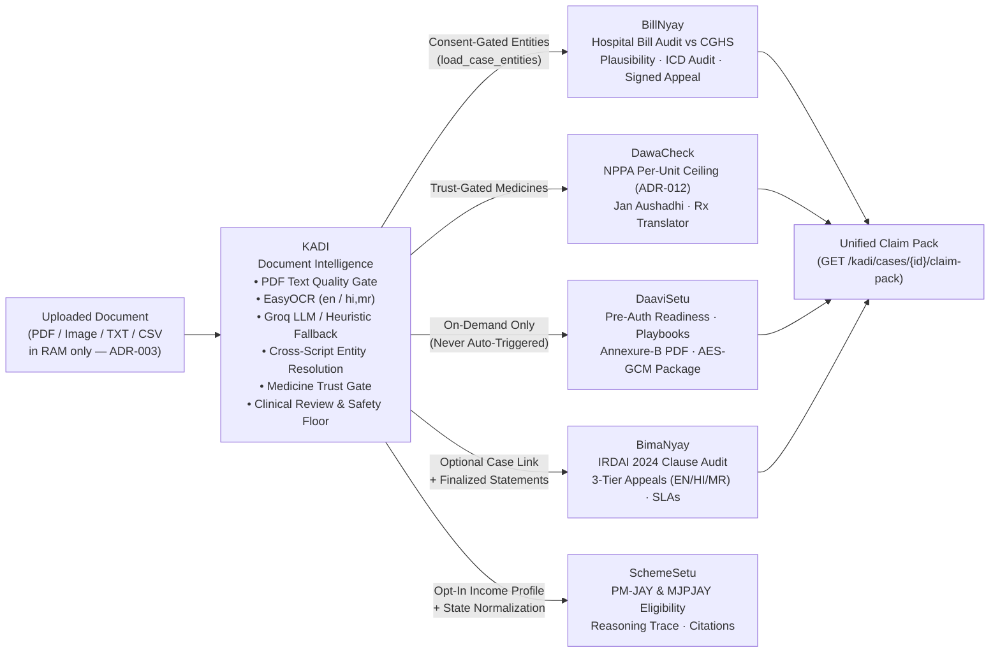

# ArogyaRakshak — Product & Ecosystem Architecture

**Status:** Approved Planning Blueprint  
**Scope:** End-to-End Platform Experience, Module Relationships, Data Boundaries & API Surface

---

## 1. Dual-Zone Experience Architecture

ArogyaRakshak is organized into **three clearly bounded experience zones** sharing one unified **Deep Forest / Warm Ivory** design language and global shell:

---

## 2. Six-Module Functional Architecture & Relationships

**Kadi** is the shared intelligence backbone (`packages/kadi`). The five domain modules (`billnyay`, `dawacheck`, `daavisetu`, `bimanyay`, `schemesetu`) are strictly independent pure-Python packages (enforced by `.importlinter`) that consume structured, consent-gated Kadi case context via `apps/api/app/services/case_context.py::load_case_entities`.

### Shared Capabilities & Consolidation Opportunities Identified

| Capability | Current State in Code | Consolidation Plan in Transformation |
|---|---|---|
| **Evidence & Provenance Badges** | 8 states in `ui/Badges.tsx`, duplicated in `PublicParts.tsx`, older modules still use ad-hoc chips | Single canonical **6-tier Semantic Visual System** mapped deterministically onto the 8 backend provenance states (`Verified`, `AI-Derived`, `Human-Reviewed`, `Needs Attention`, `Critical`, `Not Assessed`). |
| **State Feedback Panels** | Workspace uses `ui/States.tsx`; older module views use `clinical/StatePanel.tsx` | Consolidate all modules onto unified `ui/States.tsx` (`LoadingState`, `EmptyState`, `ErrorState`, `PartialResultState`, `InsufficientEvidenceState`). |
| **Data Visualisations** | `ui/Charts.tsx` (5 SVG primitives) built in M2 but unused in production; modules use bespoke CSS bars | Promote `ui/Charts.tsx` into BillNyay (Waterfall/StackedBar), DawaCheck (Comparative Bar), DaaviSetu (Donut/Ring), BimaNyay (TimelineChart), and elevate `EvidenceGraph` into the flagship Evidence Explorer. |
| **Unwired Backend Capabilities** | Backend already implements `billnyay/icd-audit`, `billnyay/grievance`, `billnyay/outcome-estimate`, `daavisetu/claim/fill-template`, `schemesetu/eligibility/{reasoning,trend,transition}`, `kadi/abdm/import` | Surface high-value existing endpoints cleanly inside their respective module workspaces (e.g., SchemeSetu Reasoning Trace & Transition, BillNyay ICD Audit & Grievance, DaaviSetu Template Fill) without inventing new backend APIs. |
| **Standalone vs Case-Linked Flows** | DawaCheck, BimaNyay, and SchemeSetu work both standalone (no case) and case-linked; currently served only under `/app/case/[module]` | Support clear dual-mode headers ("Linked to Case `AR-…`" vs "Standalone Check — Start a Case to Save") and keep `/app/tools/*` aliases redirecting or rendering cleanly. |

---

## 3. Hard Architectural & Privacy Boundaries (Never Violated)

1. **Zero Document Retention (ADR-003):** Raw uploaded bytes never touch persistent storage. The UI must **never** promise a "Document Vault", original PDF preview after upload, or original file re-download. Document views display **Document Provenance Cards**: filename, extension, SHA-256 digest, upload timestamp, extracted entities, OCR confidence, and the PII-redacted 1,000-character excerpt.
2. **Case ID Never in URL (ADR-009 / Wave 3 M4):** Active case selection is held in memory / `sessionStorage` (`arogyarakshak.activeCase.v1`), never in URL path or query params, preventing accidental token/ID leakage via shared links or browser history.
3. **90-Day TTL & Instant Erasure (ADR-010):** Every case auto-expires after `CASE_TTL_DAYS` (default 90) via the 6-hour server sweep. Both single-case deletion (`DELETE /api/v1/kadi/cases/{id}`) and full account erasure (`DELETE /api/v1/kadi/auth/me`) cascade-purge every derived record.
4. **Honest Auth & Email Boundary (ADR-026):** Account registration, login, logout, password change, case listing, and guest-case claiming work end-to-end via `__Host-arogya_session` (web) and Bearer token (mobile). Because `MAIL_TRANSPORT=disabled` is currently the only configured mail transport, `/forgot-password` and `/verify` must clearly disclose that self-service email delivery is unavailable in this deployment while supporting `#token=` links when issued.
5. **No Insurer / Government Portal Submission:** DaaviSetu and BimaNyay **prepare** dossiers, PDFs, and appeal drafts. Status labels must say *"Package Ready"* or *"Draft Prepared"*, never *"Submitted"* or *"Approved"*.
6. **No Fabricated Probabilities or Metrics:** BimaNyay's rule score is displayed as *"Rule-based starting estimate: NN / 100"*, never *"NN% win probability"*. Outcome estimation (`POST /billnyay/outcome-estimate`) honestly displays *"Insufficient Evidence"* because no non-synthetic historical dataset ships.
