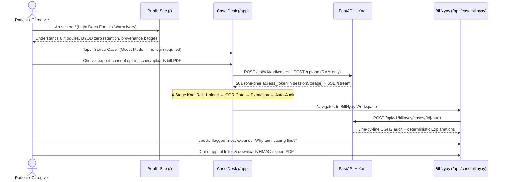

# ArogyaRakshak — End-to-End User Journeys

**Status:** Approved Planning Blueprint  
**Scope:** 7 Core User Journeys Grounded in Verified Backend Flows

---

## Journey 1: First-Time Visitor Discovery → Trust → Urgent Guest Case (Hospital Billing Desk)

**Persona:** Rohan, standing at a private hospital billing desk in Pune with a ₹1,84,500 discharge bill on his phone.  
**Goal:** Verify whether the bill is inflated without creating an account or permanently uploading sensitive medical papers.

**Friction Mitigations:**
- Zero login wall before value.
- Clear *"This tab only — Create an account later to keep this case across devices"* banner.
- Mobile-first camera scan (`capture="environment"`), instant Web Speech read-aloud (`ListenSummary`) in EN/HI/MR.

---

## Journey 2: Guest Case → Account Registration → Case Claiming (ADR-026)

**Persona:** Rohan gets home and wants to continue his hospital dispute over the next two weeks across his laptop and phone.

1. **Trigger:** Banner on `/app` or `/app/case`: *"Guest case (this tab only) · Save to an account before closing."*
2. **Registration (`/register`):** Enters email + 12+ character password (live NIST policy check). Backend returns uniform `202 Accepted` (enumeration-resistant).
3. **Sign In (`/login`):** Signs in → backend issues `__Host-arogya_session` (`httpOnly`, `SameSite=Strict`, `Secure`).
4. **Claiming (`/app`):** Case Desk detects guest case in `sessionStorage` and offers **"Keep in my account"**. Clicking invokes `POST /api/v1/kadi/cases/{id}/claim` with session cookie + `X-Case-Access-Token`.
5. **Result:** Case becomes `owned: true`; its old guest token is permanently invalidated (returns 403) and removed from `sessionStorage`. Case now appears in `GET /api/v1/kadi/cases` across devices until its 90-day TTL or manual deletion.

---

## Journey 3: Unclear Prescription → Medicine Trust Gate → Blind Dual-Reader OCR → Per-Unit Price Check

**Persona:** Meera uploads a handwritten prescription (`Scenario C`).

1. **Upload & OCR:** Kadi runs EasyOCR and detects low confidence on *"Augmntn 625"*.
2. **Trust Gate Holdback (`kadi.clinical_review.medicine_trust`):** On `/app/case/dawacheck`, the medicine is **never price-checked**. It renders with an amber **Needs Attention (`#C28A35`)** Trust Gate card: *"Held back — uncertain reading. Never price-checked until settled."*
3. **Human Transcription Escalation:** Patient flags/creates a transcription task (`POST /kadi/cases/{id}/transcriptions`) and assigns two independent readers.
4. **Blind Dual-Reading (`/review` → Transcriptions Tab):** Reader 1 and Reader 2 independently submit readings (`POST /kadi/transcriptions/{id}/readings`) blind to each other and to the software's guess.
5. **Consensus & Per-Unit Check:** When both readers agree on *"Augmentin 625"*, the entity flips to **Human-Reviewed (`#8066A5`)**. DawaCheck unlocks per-unit comparison (`price_basis=PER_TABLET`, ADR-012), displays the `PriceBar` against the NPPA ceiling, and offers Jan Aushadhi generic substitutes.

---

## Journey 4: Insurance Claim Repudiation → IRDAI Clause Audit → 3-Tier Appeal & SLA Tracking

**Persona:** Ananya receives a cashless/reimbursement denial citing a Pre-Existing Disease exclusion on a 6-year-old policy.

1. **Intake:** Uploads denial letter on `/app` (or opens `/app/case/bimanyay` standalone).
2. **Safety Floor Check:** Kadi's board-approved safety rules scan extracted text. If red-flag clinical symptoms appear (e.g., stroke signs in Scenario D), an unmissable **Critical (`#C4544F`)** Safety Escalation Banner appears immediately before financial tools.
3. **Clause Audit:** `POST /api/v1/bimanyay/analyze` flags the 5-year moratorium violation under IRDAI Master Circular (29 May 2024), shows the **Rule-based starting estimate (NN / 100)**, and highlights any unverified clause with `Needs Attention`.
4. **Appeal Studio:** Ananya switches between **Tier 1 (Insurer GRO)**, **Tier 2 (Bima Bharosa)**, and **Tier 3 (Ombudsman Form VI)** in English, Hindi, or Marathi, reviewing the deterministic Explanation Trail.
5. **SLA Tracking:** `POST /api/v1/bimanyay/timeline` renders the 15-day / 15-day / 365-day statutory deadline timeline (with optional local on-device reminders on mobile).

---

## Journey 5: Pre-Authorisation Readiness → Doctor Fact Confirmation → Encrypted Package (DaaviSetu)

**Persona:** Hospital coordinator / family preparing a planned admission dossier (`Scenario B` / `Scenario E`).

1. **Step 1 — Readiness Checklist (`/app/case/daavisetu`):** `POST /daavisetu/cases/{id}/readiness` evaluates extracted documents against the generic checklist or private institution playbook, showing a **Document Completeness Ring** (`Present`, `Needs Doctor Confirmation`, `Missing`).
2. **Doctor Confirmation:** For clinical items marked `NEEDS_CLINICAL_CONFIRMATION`, patient requests a clinical review; a named doctor on `/review` declares independence and confirms the fact (`POST /kadi/clinical-reviews/{id}/facts/{fact_id}/decision`).
3. **Step 2 — Annexure-B Form Fill:** Kadi auto-populates hospital, diagnosis, and procedure fields with inline `AI-Derived` provenance tags; user reviews and fills optional estimated cost.
4. **Step 3 — Encrypted Package:** User generates Annexure-B PDF (`GET /claim/pdf`) or ZIP (`GET /claim/package`) and optionally encrypts it locally in the browser using **PBKDF2 (600,000 iterations) → AES-256-GCM** (ADR-014). Final status: **"Package Ready"** (never "Submitted").

---

## Journey 6: Evidence Exploration & Deep Provenance Audit

**Persona:** Patient, advocate, or judge verifying *why* ArogyaRakshak flagged a billing discrepancy.

1. Opens **Evidence Explorer** (`/app/case/evidence`) from Case Overview or any *"Inspect in Evidence Graph"* link inside a module.
2. Views the interactive **Evidence Relationship Graph** (`GET /kadi/cases/{id}/graph`) linking Document Digest → Extracted Entities → Reference Rules → Findings → Clinical Statements.
3. Filters nodes by provenance (`Verified`, `AI-Derived`, `Human-Reviewed`, `Needs Attention`, `Critical`, `Not Assessed`).
4. Clicks any node (or navigates via keyboard Tab/Enter) to open the **Provenance Inspector Drawer** displaying source document + page, exact applied rule, confidence score (or *"Not recorded"*), and *"What could not be determined"*.

---

## Journey 7: Privacy Control & Permanent Erasure

**Persona:** Signed-in user who has resolved their hospital bill and wants all derived data erased immediately.

1. Navigates to **Settings → Privacy & Data Controls** (`/app/settings`).
2. Reviews what is stored (only structured entities + redacted excerpt; never raw files) and the automatic 90-day expiry countdown.
3. Clicks **"Delete Active Case"** (`DELETE /kadi/cases/{id}`) or **"Permanently Erase Account & All Cases"** (`DELETE /kadi/auth/me` with current password).
4. Confirms inside native `<dialog>` `ConfirmationDialog` (focus defaults safely to Cancel).
5. Backend `purge_case` cascades deletion across all 28 tables, clears active SSE status, revokes sessions, and returns confirmation of exact cases erased.
